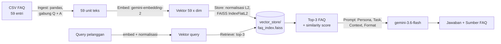

# Semantic Search & LLM Application FAQ E-Commerce

**Individual Assignment AI Engineering Bootcamp (ReWork)**
Advanced Prompt Engineering & Context Management
Peserta: **Habibie Dzaky Lathif**

Prototype asisten customer service yang mencari entri FAQ paling relevan dengan **semantic search** (Gemini Embeddings + FAISS), lalu menyusun jawaban natural dengan **LLM** (Gemini) yang hanya berpegang pada FAQ hasil retrieval.

---

## 1. Problem Statement

### Objective
Tim customer service sebuah e-commerce menerima ratusan pertanyaan repetitif setiap hari seputar pemesanan, pengiriman, pembayaran, hingga pengembalian barang. Tujuan prototype ini adalah:

1. **Menemukan entri FAQ paling relevan** terhadap pertanyaan pelanggan, **walaupun pelanggan tidak memakai kata-kata yang sama** dengan FAQ (pencarian berdasarkan makna, bukan kata kunci).
2. **Menyusun jawaban yang natural** menggunakan LLM berdasarkan FAQ yang ditemukan, sehingga pertanyaan repetitif dapat dijawab otomatis.
3. Menjadi **prototype awal** sebelum dikembangkan menjadi RAG system yang lebih kompleks.

### Sumber dan Struktur Knowledge Base
- **Sumber:** `data/ecommerce_faq_knowledge_base.csv`, knowledge base FAQ yang dibagikan pada assignment. File disimpan apa adanya dan tidak diubah.
- **Ukuran:** 59 entri, 4 kolom, tanpa nilai kosong, `faq_id` unik.

| Kolom | Tipe | Keterangan |
|---|---|---|
| `faq_id` | integer | ID unik entri FAQ (1–59) |
| `category` | string | Kategori topik |
| `question` | string | Pertanyaan FAQ |
| `answer` | string | Jawaban resmi FAQ |

| Kategori | Jumlah entri |
|---|---|
| Pemesanan | 9 |
| Pengiriman | 9 |
| Pembayaran | 8 |
| Pengembalian | 8 |
| Akun | 7 |
| Produk | 7 |
| Promo | 6 |
| Customer Service | 5 |
| **Total** | **59** |

Setiap entri pendek (satu pertanyaan dan satu atau dua kalimat jawaban), sehingga **satu entri = satu unit retrievable** tanpa chunking.

### Batasan dan Asumsi
- Sistem **hanya menjawab berdasarkan FAQ** di knowledge base. Jika informasi tidak tersedia, sistem menyampaikan bahwa informasinya belum ada dan menyarankan menghubungi customer service, bukan menebak dari pengetahuan umum LLM.
- Knowledge base **tidak diubah** dan **tidak ditambah** dari sumber lain.
- Pertanyaan dan jawaban dalam **Bahasa Indonesia**.
- Setiap pertanyaan dijawab **secara independen** (tanpa riwayat percakapan atau data pesanan pelanggan). Sistem tidak bisa mengecek status pesanan atau resi tertentu.
- **Chunking tidak diterapkan** karena setiap entri sudah pendek dan memang bukan learning objective sesi ini.
- Ini adalah **prototype**: tidak ada antarmuka pengguna, autentikasi, maupun deployment.

---

## 2. Alur Sistem

```
ingest  -> embed  ->  store  -> retrieve ->  generate
```



| Tahap | Implementasi | Section notebook |
|---|---|---|
| **Ingest** | Memuat CSV dengan Pandas, memeriksa struktur data (jumlah entri, kolom, kategori, nilai kosong, duplikasi, panjang teks), lalu menggabungkan `question` + `answer` menjadi satu teks per entri: `Q: <question> A: <answer>`. | 1, 2 |
| **Embed** | Setiap unit teks diubah menjadi vektor dengan Gemini Embeddings API (`gemini-embedding-2`). Shape, dimensi, dan nilai NaN/inf diverifikasi sebelum disimpan. | 3 |
| **Store** | Vektor dinormalisasi (norma = 1) lalu dimasukkan ke FAISS `IndexFlatL2`. Jumlah vektor diverifikasi sama dengan jumlah entri (59), lalu index disimpan ke `vector_store/faq_index.faiss` dan dibaca ulang untuk verifikasi. | 4 |
| **Retrieve** | `semantic_search(query, top_k=3)` meng-embed query, menormalisasi, mencari 3 tetangga terdekat, lalu mengembalikan FAQ beserta **distance** (L2 kuadrat) dan **similarity** (cosine = 1 − distance/2). | 5 |
| **Generate** | `build_prompt()` menyisipkan top-3 FAQ ke bagian Context dalam prompt terstruktur. `generate_answer()` menggabungkan retrieval → prompt → Gemini (`gemini-3.6-flash`, temperature 0.3) dalam satu alur. | 6, 7 |

**Mengapa vektor dinormalisasi?** Dengan vektor ber-norma 1, jarak L2 kuadrat dari FAISS setara dengan cosine similarity (`cosine = 1 − d/2`). Index tetap `IndexFlatL2` seperti di starter notebook dan urutan peringkat tidak berubah, tetapi skor bisa dibaca sebagai similarity yang lebih intuitif.

### Desain Prompt

| Bagian | Isi |
|---|---|
| **Persona** | Asisten customer service e-commerce di Indonesia; ramah, sopan, ringkas, Bahasa Indonesia natural. |
| **Task** | (1) Jawab **hanya** dari Context, tanpa pengetahuan umum. (2) Context berisi hasil pencarian otomatis yang belum tentu semuanya relevan, jadi pakai FAQ yang benar-benar menjawab dan abaikan sisanya. (3) Jika info tidak cukup, jangan menebak: katakan belum tersedia di knowledge base dan sarankan menghubungi customer service. (4) Jika hanya sebagian terjawab, jawab bagian itu dan sebutkan bagian yang belum tersedia. |
| **Context** | Top-3 FAQ hasil semantic search, masing-masing dengan nomor FAQ dan kategori. |
| **Format** | Maksimal 4 kalimat; poin bernomor hanya untuk langkah-langkah; diakhiri baris `Sumber: FAQ #<nomor>` atau `Sumber: -` jika informasi tidak tersedia. |

Baris `Sumber` membuat setiap jawaban bisa ditelusuri ke FAQ asalnya, dan `Sumber: -` menjadi penanda eksplisit bahwa sistem mengakui ketidaktahuannya.

### Catatan Model
Starter notebook memakai `text-embedding-004` dan `gemini-2.0-flash`. Menurut halaman resmi [Gemini API Deprecations](https://ai.google.dev/gemini-api/docs/deprecations), kedua model tersebut sudah dimatikan (`text-embedding-004` per 14 Januari 2026, `gemini-2.0-flash` per 1 Juni 2026), sehingga notebook akan error jika tetap memakainya. Project ini memakai pengganti resmi yang direkomendasikan Google:

| Fungsi | Starter notebook | Dipakai di project ini |
|---|---|---|
| Embedding | `text-embedding-004` | `gemini-embedding-2` |
| LLM | `gemini-2.0-flash` | `gemini-3.6-flash` |

Cara pemanggilan API (`client.models.embed_content` dan `client.models.generate_content`) tetap sama dengan starter notebook. Nama model diatur di satu tempat (`EMBEDDING_MODEL` dan `LLM_MODEL` di Section 1).

---

## 3. Hasil Pengujian dan Analisis Relevansi

### Rancangan Query Uji
`expected_faq_ids` ditentukan dengan membaca isi knowledge base **sebelum** pengujian, lalu dibandingkan dengan hasil retrieval (Hit@1 = FAQ benar di peringkat 1; Hit@3 = FAQ benar masuk 3 teratas yang dikirim ke LLM).

| # | Jenis | Query | FAQ yang diharapkan |
|---|---|---|---|
| Q1 | Jelas ada di KB | Metode pembayaran apa saja yang tersedia? | #17 |
| Q2 | Jelas ada di KB | Bagaimana cara membatalkan pesanan yang sudah dibuat? | #3 |
| Q3 | Parafrase / sinonim | uang saya sudah kepotong tapi orderan masih dibilang belum dibayar, gimana nih? | #21 |
| Q4 | Parafrase / sinonim | barang yang datang pecah waktu kardusnya saya buka, saya harus ngapain? | #16 |
| Q5 | Tidak ada di KB | Apakah bisa kirim barang ke luar negeri? | – |

- **Q1–Q2** memakai kalimat yang sama dengan pertanyaan FAQ (baseline).
- **Q3–Q4** sengaja menghindari kata kunci FAQ dan memakai bahasa sehari-hari (*dipotong-> kepotong*, *status pesanan-> orderan*, *belum terbayar-> belum dibayar*, *kondisi rusak-> pecah*, *paket diterima-> kardusnya saya buka*).
- **Q5** masih satu domain (pengiriman), tetapi knowledge base tidak membahas pengiriman internasional. Query ini menguji apakah sistem tetap menolak menjawab walaupun FAQ pengiriman yang mirip ikut terambil.

### Hasil

>**Diisi setelah notebook dijalankan dengan API key.** Hasil lengkap (top-3 FAQ, similarity, distance, dan jawaban LLM per query) tersimpan otomatis di [`documentation/retrieval_test_results.md`](documentation/retrieval_test_results.md).


## 4. Keterbatasan Sistem

Keterbatasan dari desain sistem:

1. **Tidak ada ambang batas (threshold) relevansi.** Retrieval selalu mengembalikan 3 FAQ, sekalipun tidak ada yang relevan. Penolakan untuk pertanyaan di luar knowledge base sepenuhnya bergantung pada kepatuhan LLM terhadap instruksi prompt.
2. **Top-k tetap (k = 3).** Pertanyaan yang membutuhkan lebih dari 3 FAQ (misalnya pertanyaan gabungan) bisa kehilangan informasi.
3. **Satu vektor per entri (Q + A digabung).** Representasi ini menyatukan topik pertanyaan dan isi jawaban. Kata-kata di jawaban bisa membuat sebuah FAQ ikut terambil untuk query yang sebenarnya menanyakan hal lain.
4. **Tanpa konteks percakapan dan data transaksi.** Setiap query diproses terpisah, sehingga pertanyaan lanjutan ("kalau yang tadi gimana?") atau pertanyaan tentang pesanan spesifik tidak bisa dijawab.
5. **Knowledge base kecil dan statis (59 entri).** Banyak pertanyaan wajar pelanggan belum tercakup, dan setiap perubahan FAQ mengharuskan embedding serta index dibuat ulang.
6. **Bergantung pada API eksternal.** Kuota/rate limit, perubahan atau penghentian model (seperti model di starter notebook), dan latensi jaringan memengaruhi sistem. Index yang tersimpan hanya kompatibel dengan model embedding yang sama.


---

## 5. Struktur Repository

```
assignment-semantic-search-habibiedzakylathif/
├── data/
│   └── ecommerce_faq_knowledge_base.csv     # knowledge base asli (tidak diubah)
├── notebook/
│   └── starter_notebook_semantic_search.ipynb  # seluruh pipeline: ingest -> embed-> store-> retrieve-> generate +-> uji
├── vector_store/
│   └── faq_index.faiss                      # FAISS index (dibuat oleh notebook, Section 4)
├── documentation/
│   └── retrieval_test_results.md            # hasil pengujian (dibuat oleh notebook, Section 8)
├── .env.example                             # template API key
├── .gitignore
├── README.md
└── requirements.txt
```

Pemetaan ke output yang dikumpulkan:

| Output | Lokasi |
|---|---|
| Document/knowledge base processing code | Notebook Section 1–2 |
| Embedding pipeline code | Notebook Section 3 |
| Vector database (FAISS index) beserta script pembuatannya | `vector_store/faq_index.faiss` + Notebook Section 4 |
| Semantic search function | Notebook Section 5 (`semantic_search`) |
| LLM-powered response function | Notebook Section 6–7 (`build_prompt`, `generate_answer`) |
| Hasil pengujian relevansi (min. 5 query) beserta analisis | Notebook Section 8, `documentation/retrieval_test_results.md`, README bagian 3 |
| File requirements.txt | `requirements.txt` |

---

## 6. Cara Menjalankan

**Prasyarat:** Python 3.10 atau lebih baru dan API key Gemini (dari [Google AI Studio](https://aistudio.google.com/apikey)).

```bash
# 1. Clone repository
git clone https://github.com/<username>/assignment-semantic-search-habibiedzakylathif.git
cd assignment-semantic-search-habibiedzakylathif

# 2. Buat dan aktifkan virtual environment
python -m venv .venv
source .venv/bin/activate          # Windows: .venv\Scripts\activate

# 3. Install dependencies
pip install -r requirements.txt

# 4. Siapkan API key
cp .env.example .env               # Windows: copy .env.example .env
# lalu buka .env dan isi GEMINI_API_KEY=<api key Anda>

# 5. Jalankan notebook
jupyter notebook notebook/starter_notebook_semantic_search.ipynb
```

Di Jupyter, pilih **Kernel lalu Restart & Run All**. Notebook akan:
1. memuat dan memeriksa knowledge base,
2. membuat 59 embedding (59 panggilan API embedding),
3. membuat FAISS index dan menyimpannya ke `vector_store/faq_index.faiss`,
4. menjalankan contoh semantic search dan contoh jawaban LLM,
5. menjalankan 5 query uji dan menyimpan hasilnya ke `documentation/retrieval_test_results.md`.

Alternatif tanpa membuka Jupyter (output tersimpan ke notebook):

```bash
jupyter nbconvert --to notebook --execute --inplace notebook/starter_notebook_semantic_search.ipynb
```

**Catatan:**
- Jika terkena rate limit (HTTP 429) atau gangguan server sementara (500/503), notebook otomatis menunggu lalu mencoba ulang hingga 5 kali.
- File `.env` sudah masuk `.gitignore` sehingga API key tidak ikut ter-commit.
